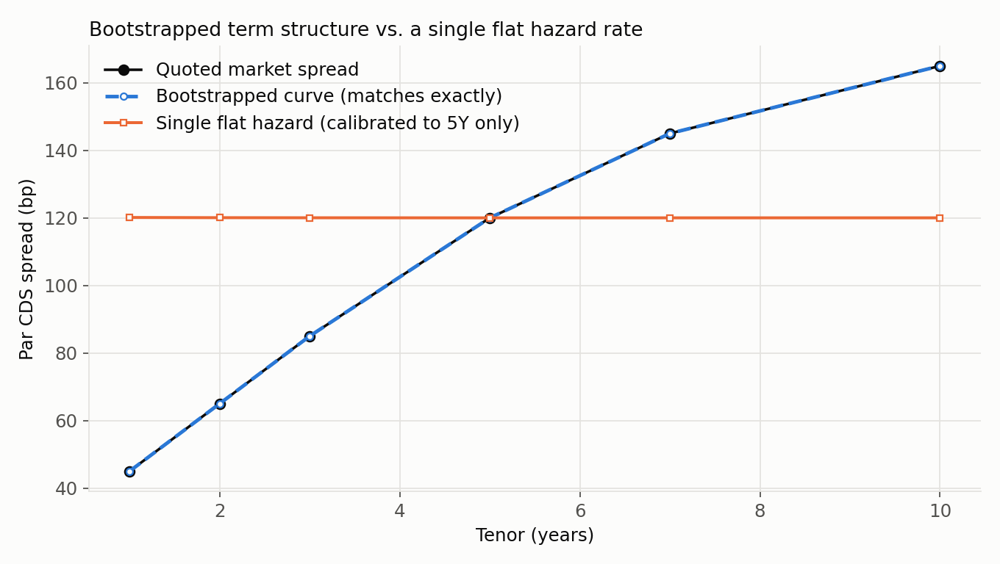
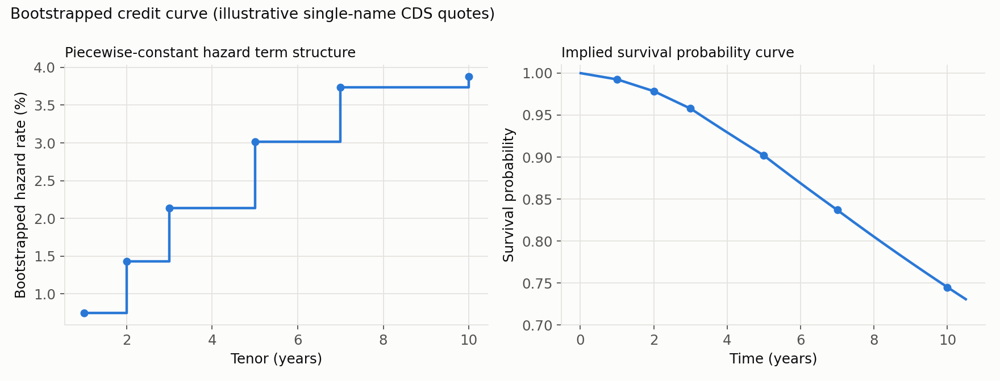
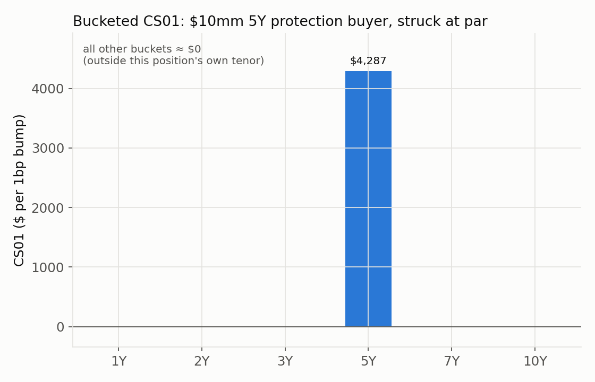

# Credit Curve Bootstrapper

A single-name CDS hazard-rate and survival-probability curve bootstrapper, implemented in C++23 (`cpp/`) and in Python with NumPy and SciPy (`python/`). Both implementations have their own test suites and are cross-checked against each other.

Given a term structure of quoted CDS spreads (for example 1Y, 2Y, 3Y, 5Y, 7Y and 10Y), the library:

1. Bootstraps a piecewise-constant hazard-rate curve whose model par spread matches every quoted tenor exactly. A single flat hazard rate can match only one point (see the comparison chart below).
2. Prices the premium and protection legs of a CDS off that curve, including the accrued premium on default.
3. Computes bucketed and parallel CS01 for a position on the curve.
4. Validates every non-trivial result in at least one independent way: C++ against Python, a hand-written root finder against a library one, and a round trip that recovers a known input curve.

## Quick start

```bash
# C++
cd cpp && mkdir -p build && cd build && cmake .. -DCMAKE_BUILD_TYPE=Release && make -j4
./run_tests         # 33 tests
./bootstrap_cli     # bootstraps the illustrative curve and prints hazard rates, CS01
                    # and the comparison with a single flat hazard rate

# Python
cd python && pip install -e ".[dev]"
python3 -m pytest -q                  # 34 tests
python3 scripts/generate_results.py   # writes results/*.csv and summary.txt
python3 scripts/plot_results.py       # writes results/*.png
python3 scripts/benchmark.py          # vectorized vs. naive Python loop timing
```

## Implementation comparison

| | C++ | Python |
|---|---|---|
| Root finding | Hand-written Brent's method (`root_finder.cpp`) with no external dependency | `scipy.optimize.brentq` is the primary solver. A hand-written bisection (`root_finder.py`) independently cross-checks it. |
| CDS leg pricing | Explicit loops over the payment schedule and integration grid | Vectorized NumPy array operations, over 250x faster per call than a naive Python loop (see `python/scripts/benchmark.py`) |
| Curve interpolation | Linear scan over pillars | A single `numpy.interp` call |
| Testing | Custom `TEST`, `CHECK` and `CHECK_CLOSE` macros, 33 tests | `pytest`, 34 tests |

**Cross-language agreement:** both engines bootstrap the same illustrative quotes to hazard rates and CS01 figures that agree to at least 9 significant figures. A dedicated test on each side (`test_cross_language`) enforces this against the other engine's full-precision output. For example, the 5Y hazard rate is `3.0121700882%` in both.

## Results

These results use the illustrative synthetic quotes described under "Inputs" below.

The bootstrap matches all 6 quoted tenors to within 3×10⁻¹⁰ bp, which is floating-point precision. A single flat hazard rate calibrated only to the 5Y point misprices the 1Y quote by 75 bp and the 10Y quote by 45 bp.



The resulting hazard-rate term structure and survival-probability curve:



For a $10mm 5Y protection buyer struck at par, the CS01 is concentrated entirely in the 5Y bucket. Every other bucket is zero to within machine precision, for the structural reason explained under "Key findings".



## Inputs

The discount curve and CDS quotes used throughout (`cpp/apps/main.cpp` and `python/scripts/*`) are a fixed, illustrative term structure for a hypothetical BBB-rated name. The spreads slope upward from 45 bp at 1Y to 165 bp at 10Y, against a mildly inverted illustrative OIS curve. They are synthetic inputs, not live market quotes. The bootstrap, pricing and risk calculations are the same as they would be on market data.

## Key findings

**A single flat hazard rate cannot fit a term structure.** It matches exactly one quoted point, the one it is calibrated to, and misprices every other tenor, often by tens of basis points. This is why a piecewise curve is bootstrapped instead.

**CS01 for an at-the-money position is a step function across pillars.** One might expect bumping a nearby tenor such as 3Y to move a 5Y position's CS01 slightly, as it would on a smoothly interpolated curve. Instead, every bucket other than the position's own maturity is exactly zero, to about 1e-9. The reason is algebraic. For a position struck at the par spread of tenor T, `MTM = notional × riskyAnnuity(T) × (parSpread(T) − contractSpread)`. The sequential bootstrap guarantees that `parSpread(T)` reproduces the quote for T regardless of the hazard rates on other pillars, so the second factor stays zero unless the T quote itself moves. Both test suites verify this with `cs01_is_exactly_zero_for_every_pillar_except_the_positions_own_tenor`.

**Discretization error is small and measured.** In the continuous-payment limit, the credit triangle gives par spread ≈ `(1 − recovery) × hazard`, a closed-form check that is independent of the discount curve. The quarterly-premium pricer with accrued premium on default reproduces it to about 0.38% relative error, so the tests assert a 1% tolerance.

## Design notes and limitations

- Recovery is fixed at 40%, the standard assumption for senior unsecured debt. Recovery and hazard rate cannot be identified separately from CDS spreads alone, so most practitioner bootstrappers fix it as well.
- The discount curve uses log-linear interpolation in the zero rate with flat extrapolation. It is not itself bootstrapped from swap or OIS instruments, which keeps the focus on the credit curve.
- The protection leg is priced by numerical integration at 200 steps per year rather than a closed form, because the zero-rate curve is not piecewise flat. The resulting discretization error is measured above.
- CS01 is computed by fully re-bootstrapping the curve for each bucket rather than through a closed-form Jacobian. This is simple and transparent, and it is the slowest part of the pipeline for large curves.
